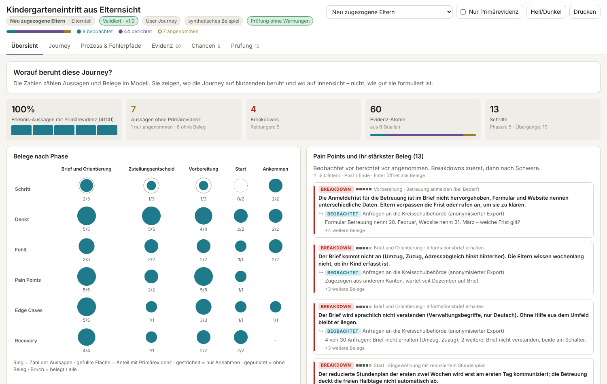
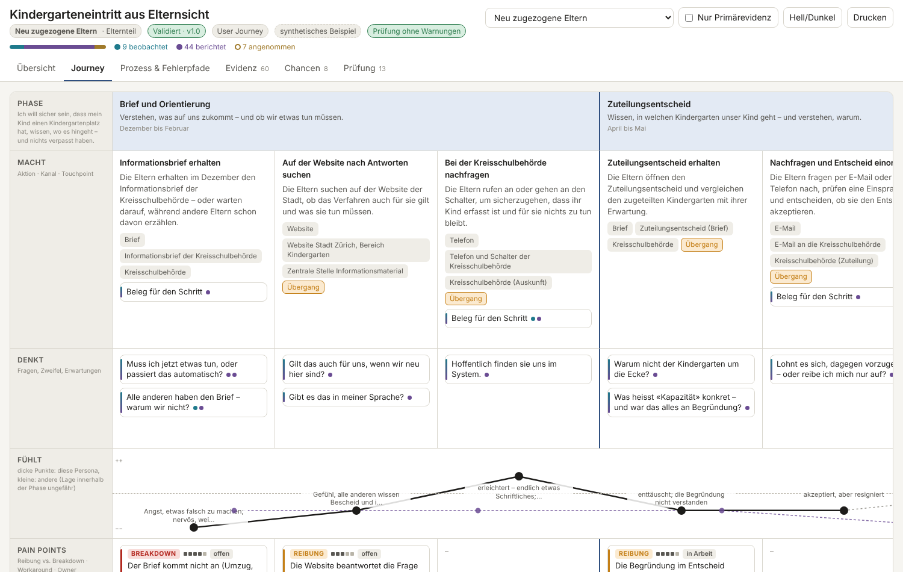

# JourneyKit


> Evidenzbasierte User Journeys für die öffentliche Verwaltung: ein JSON-Modell, in dem jede Aussage auf Evidenz verweist, Lints für die bekannten Fallstricke des Journey Mappings, ein interaktiver Single-File-Viewer und ein portabler Claude-Skill, der Journeys aus Rohmaterial synthetisiert.

🇬🇧 [English Version](README.md)

## Übersicht

Die meisten Journey Maps sind Poster: im Sitzungszimmer entstanden, auf den Happy Path verengt, nie aktualisiert, nie in Arbeit übersetzt. JourneyKit behandelt eine Journey als **Datenbestand, nicht als Bild**. Das Primärartefakt ist eine JSON-Datei (`journey.json`) mit Persona, Szenario, Phasen, Schritten, Pain Points, Recovery-Pfaden, Kennzahlen und Chancen – und jede Aussage darin verweist auf **Evidenz-Atome** (Zitate, Messwerte, Beobachtungen) mit Quelle und Evidenzklasse: *beobachtet*, *berichtet* oder *angenommen*. HTML, Story Map, Massnahmenliste, Audit-Report und Versionsvergleich werden aus diesem Modell erzeugt.

Das Vokabular ist für die Verwaltung übersetzt, wo niemand «konvertiert» oder «churnt» – Menschen weichen aus: ans Telefon, an den Schalter, in eine Beschwerde oder ins Nichthandeln. Inhalte sind deutsch in Schweizer Rechtschreibung; die Feldnamen des Schemas sind englisch.

## Funktionen

- **Journey-Modell** als JSON Schema (Draft 2020-12) mit Evidenz-Atomen, Quellenregister, Datenschutzstatus, Owner und Review-Rhythmus
- **Methodische Lints** für die fünf Fallstricke – Inside-Out Bias, Happy Path Bias, Static Map Trap, Empathie-Vakuum / Überkomplexität, Micro-Level Disconnect – plus Blueprint-Smell, Personendaten, KPI-Übersetzung und Evidenzqualität (L001–L103)
- **Interaktiver Viewer**: eine eigenständige HTML-Datei mit sechs Layern – Übersicht (Anteil belegter Erlebnis-Aussagen, auch je Phase; Aussagen ohne Primärevidenz; Belege nach Aussageart und Phase als Kreismatrix; jeder Pain Point mit seinem stärksten Beleg, per Tastatur bedienbar), Journey Map mit emotionaler Kurve, belegter Dauer je Phase auf einem gemeinsamen Massstab, den Kosten, die je Schritt fällig werden, und Verweisen von einem Pain Point auf seine Ursache, Prozess- und Fehlerpfade, Evidenz-Heatmap und Quellenregister, Impact/Effort-Matrix mit User Stories, Prüfung, dazu mit `--compare` der Vergleich mit einer früheren Fassung (Zahlen der Übersicht vorher → nachher, Belege je Phase, beide Gefühlskurven übereinander, jede Modelländerung mit Sprung in die Journey) – Evidenz-Drilldown bis zum O-Ton auf jeder Zelle, Filter «nur Primärevidenz», Persona-Überlagerung, hell/dunkel, Druck, Oberfläche deutsch oder französisch
- **Exporte**: Story Map nach Patton (Markdown), Massnahmenliste (CSV), Chancenmatrix, Audit-Report (Diagnose, Urteilsvorschlag, nächste Schritte, Kosten, Befunde), Evidenz-Heatmap als eigenständiges SVG-Bild für Berichte und Präsentationen oder als CSV – auch direkt im Evidenz-Layer des Viewers zum Speichern
- **Diff** zwischen zwei Versionen – was hat neue Evidenz verändert?
- **Claude-Skill** `user-journey` mit drei Modi: *Synthese* (Rohmaterial → Journey), *Workshop* (Hypothesis-first mit Erhebungsplan), *Audit* (bestehende Journey prüfen)
- **Durchgerechnete Beispiele**: Kindergarteneintritt aus Elternsicht, aus einem synthetischen Inputmix (3 Interviews, 30 Anfragen, Befragung, Webanalytics, internes Prozessdokument, Workshop-Notizen); dazu eine Baubewilligung für eine Wärmepumpe (Bauherrschaft und Nachbarschaft als zwei Personas) und die Anmeldung an einer Musikschule (Eltern, Warteliste, Tarifermässigung, Abmeldung über die Lehrperson). Die beiden prüfen die Übertragbarkeit auf andere Bereiche und halten fest, wo das Modell an Grenzen stösst – Kosten, Ursachenketten, Fristen der Persona

### Demo





`examples/kindergarteneintritt/journey.html` im Browser öffnen für die vollständige interaktive Fassung.

## Voraussetzungen

- Python 3.10+
- `jsonschema` (wird automatisch installiert)
- Keine JavaScript-Toolchain: der Viewer ist HTML, CSS und JS in einer Datei

## Installation

```bash
git clone https://github.com/malkreide/journeykit.git
cd journeykit
pip install -e ".[dev]"
```

Wird `journeykit` danach nicht gefunden (typisch bei Windows-Nutzerinstallationen, wo pip die Skripte nach `%APPDATA%\Python\Python3xx\Scripts` legt), stattdessen `python -m journeykit …` verwenden – jeder Befehl unten funktioniert auch so.

## Verwendung / Schnellstart

```bash
# Gegen das Schema prüfen
journeykit validate examples/kindergarteneintritt/journey.json

# Methodische Lints (ERROR / WARN / INFO)
journeykit lint examples/kindergarteneintritt/journey.json

# Interaktiven Viewer erzeugen (mehrere Dateien = Persona-Vergleich;
# --compare nimmt eine frühere Fassung derselben Journey dazu, zugeordnet über meta.id)
journeykit render examples/kindergarteneintritt/journey.json \
                  examples/kindergarteneintritt/journey-berufstaetig.json \
                  --compare examples/kindergarteneintritt/workshop-hypothese.json -o journey.html

# Exporte
journeykit export examples/kindergarteneintritt/journey.json --format storymap
journeykit export examples/kindergarteneintritt/journey.json --format actions -o massnahmen.csv
journeykit export examples/kindergarteneintritt/journey.json --format audit
journeykit export examples/kindergarteneintritt/journey.json --format heatmap-svg -o heatmap.svg

# Was hat Nutzerevidenz gegenüber der Workshop-Hypothese verändert?
journeykit diff examples/kindergarteneintritt/workshop-hypothese.json \
                examples/kindergarteneintritt/journey.json

# Neue Journey anlegen (Status hypothesis)
journeykit new kita-anmeldung --title "Kita-Anmeldung" --persona "Eltern" --role "Elternteil" --goal "Platz sicher haben" -o kita.json
```

## Verfügbare Befehle

| Befehl | Beschreibung |
|---|---|
| `journeykit validate DATEI... [--lang de\|fr]` | JSON-Schema-Validierung (Exit 2 bei Fehlern) |
| `journeykit lint DATEI... [--strict] [--quiet] [--format json] [--today DATUM] [--lang de\|fr]` | Fallstrick-Lints; `--strict` lässt Warnungen scheitern. Meldungen deutsch oder französisch (Standard: `meta.language` der Datei) |
| `journeykit render DATEI... [--compare ALT]... [-o OUT] [--title T] [--lang de\|fr]` | Eigenständiges interaktives HTML; mehrere Dateien überlagern Personas, `--compare` nimmt eine frühere Fassung dazu (zugeordnet über `meta.id`) und zeigt den Tab «Vergleich» / «Comparaison». Oberfläche und Lint-Meldungen deutsch oder französisch (Standard: `meta.language` der ersten Datei); Inhalte der Journey bleiben, wie sie sind |
| `journeykit export DATEI --format storymap\|actions\|opportunities\|audit\|heatmap-svg\|heatmap-csv [-o OUT] [--lang de\|fr]` | Markdown- / CSV- / SVG-Exporte; Markdown und SVG deutsch oder französisch (Standard: `meta.language`), die CSV-Dateien haben technische Spaltennamen |
| `journeykit diff ALT NEU [-o OUT] [--lang de\|fr]` | Modelländerungen zwischen Versionen (Exit 1, wenn es Änderungen gibt); Report deutsch oder französisch (Standard: `meta.language` der neuen Version) |
| `journeykit new ID --title --persona --role --goal [--lang de\|fr]` | Gerüst einer validen Journey im Status `hypothesis`; `--lang` setzt `meta.language` und die Sprache der Platzhalter |
| `journeykit schema` | JSON Schema ausgeben |

Sprache aller Ausgaben: `--lang` je Befehl, sonst `meta.language` der Journey, sonst die Umgebungsvariable `JOURNEYKIT_LANG` (`de` oder `fr`), sonst Deutsch. Texte, die argparse selbst erzeugt («usage:», «options:»), und die Details der Schemafehler bleiben wie bisher englisch.

### Lint-Regeln

| Bereich | Fallstrick | Beispiele |
|---|---|---|
| L001–L004 | Integrität | hängende Evidenz-Referenzen, doppelte IDs, widersprüchliche Phasendauer (min > typisch oder typisch > max), widersprüchliche Kostenspanne (min > Betrag oder Betrag > max), unbekannte Ursache eines Pain Points oder eine Ursache, die erst nach ihrer Folge kommt |
| L010–L012 | Inside-Out Bias | Erlebnis-Aussagen ohne Primärevidenz oder gar keine; Persona auf weniger als 3 Primärbelegen |
| L020–L023 | Happy Path Bias | keine Breakdowns; Phase ohne Reibung oder Edge Case; Breakdown ohne Recovery-Pfad; Kanal- oder Zuständigkeitswechsel nicht als Übergang markiert |
| L030–L035 | Static Map Trap | kein Owner, kein Review-Rhythmus, schwerer Pain Point ohne Owner; kein Datum |
| L040–L043 | Empathie-Vakuum | Schritte ohne Gefühle oder Gedanken; Emotionen ohne Beleg |
| L050–L054 | Überkomplexität | zu viele Phasen/Schritte; kein Scope-Ausschluss; kein Endzustand; kein Auslöser |
| L060–L065 | Micro-Level Disconnect | keine Chancen; schwerer Pain Point ohne Chance; keine Stories; Chance ohne Bezug zu Pain Point oder Phase; Chance, die nur bei Folgen ansetzt, nicht bei deren Ursache |
| L070–L073 | Blueprint-Smell | keine Diagnose; mehr Back-Stage-Notizen als Schritte; mehrheitlich Schritte, die Dritte anstelle der Persona ausführen |
| L080–L081 | Personendaten | Quelle enthält Personendaten; E-Mail-/Telefonmuster im Evidenztext |
| L090–L092 | Kennzahlen | keine; kommerzielle Benennung; kein Frühindikator |
| L100–L103 | Evidenzqualität | unbenutzte Atome; Widersprüche; Primärevidenz ohne Fundstelle; Kosten, die nur Annahmen wie eine Gebührenordnung belegen |

## Den Claude-Skill verwenden

Der Skill liegt in `skill/user-journey/`. Claude darauf zeigen (Claude Code: der Ordner wird über `CLAUDE.md` erschlossen; claude.ai: den Ordner als Skill hochladen) und das Material beschreiben. Der Skill diagnostiziert zuerst – *ist das eine User Journey oder ein Service Blueprint?* –, wählt einen Modus, registriert Quellen mit Datenschutzstatus, extrahiert Evidenz-Atome mit Fundstellen, synthetisiert das Modell und lässt die Lints laufen. Er erfindet keine Emotionen, besteht auf Breakdowns und Recovery-Pfaden und sagt offen, wenn das Material nur eine Hypothesen-Map trägt.

## Konfiguration

Keine. Der Viewer hat keine externen Abhängigkeiten und macht keine Netzwerkanfragen; gerenderte HTML-Dateien lassen sich in geschlossenen Netzen teilen.

## Projektstruktur

```
journeykit/
├── src/journeykit/
│   ├── schema/journey.schema.json   # das Journey-Modell (einzige Quelle der Wahrheit)
│   ├── model.py                     # Index und Aussagen-Iterator über eine Journey
│   ├── validate.py                  # JSON-Schema-Validierung
│   ├── lint.py                      # Fallstrick-Regeln L001–L103
│   ├── lint_messages.py             # Meldungen und Hinweise, deutsch und französisch
│   ├── render.py                    # injiziert Daten in den Viewer
│   ├── export.py                    # Story Map, Massnahmen-CSV, Chancen, Audit, Heatmap
│   ├── export_texts.py              # Texte der Exporte und des Diffs, deutsch und französisch
│   ├── diff.py                      # Versionsvergleich
│   ├── cli.py                       # Befehl journeykit
│   ├── cli_texts.py                 # Meldungen und Hilfe der CLI, deutsch und französisch
│   └── viewer/viewer.html           # eigenständiger interaktiver Viewer
├── skill/user-journey/              # Claude-Skill: SKILL.md + references/ + evals/ (Testsatz Extraktion)
├── examples/kindergarteneintritt/   # durchgerechnetes, synthetisches Beispiel inkl. Rohmaterial
├── examples/baubewilligung/        # zweiter Bereich: Übertragbarkeitsprüfung und Befunde
├── examples/musikschule/           # dritter Bereich: Kosten, vermeidbare Kontakte, Fristen
├── docs/                            # Konzept, Architekturentscheide, Demo-Bild
├── scripts/                         # Repo-Prüfungen, Scorer für den Testsatz Extraktion
├── tests/                           # pytest
└── CLAUDE.md                        # Einstieg für die Arbeit an diesem Repo mit Claude Code
```

## Changelog

Siehe [CHANGELOG.md](CHANGELOG.md)

## Mitwirken

Beiträge sind willkommen — siehe [CONTRIBUTING.md](CONTRIBUTING.md).

## Sicherheit

Schwachstellen bitte wie in [SECURITY.md](SECURITY.md) beschrieben melden. Journey-Dateien können Zitate realer Personen enthalten: vor dem Teilen anonymisieren (`pii_status`).

## Lizenz

MIT-Lizenz — siehe [LICENSE](LICENSE)

## Autor

Hayal Özkan · [malkreide](https://github.com/malkreide)
